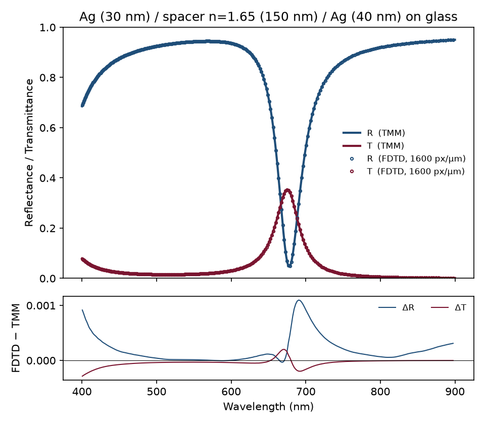
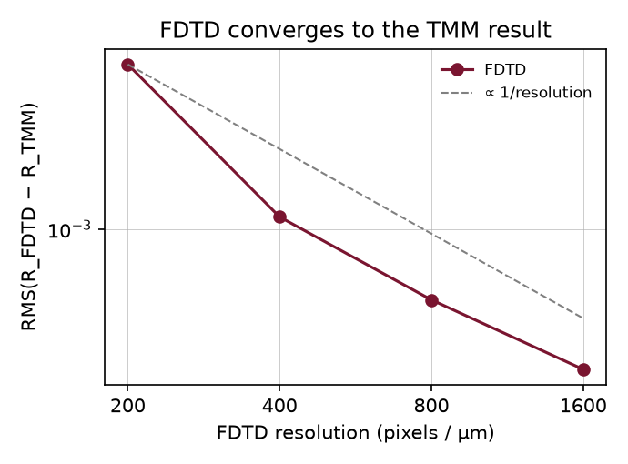
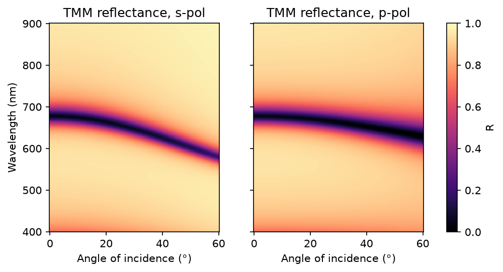

# 01 – Ag/dielectric/Ag microcavity: FDTD (Meep) vs transfer-matrix method

## Goal

Before full-wave methods can be trusted on structures where no analytical answer exists (such as metasurfaces), they should reproduce a structure where one does. A planar Fabry–Pérot microcavity is that test case. It is also the type of structure I fabricated and measured during my PhD.

## Structure

| Layer | Material | Thickness |
|---|---|---|
| incident medium | air | – |
| top mirror | Ag | 30 nm |
| spacer | dielectric, n = 1.65 (ALD Al₂O₃-like) | 150 nm |
| bottom mirror | Ag | 40 nm |
| substrate | glass, n = 1.50 | – |

Silver uses Meep's built-in Drude–Lorentz fit (Rakić et al., 1998). The TMM evaluates the **same** dispersion model, so any difference between the two methods is numerical, not a difference in material data. All parameters are in [`src/stack.py`](src/stack.py).

## Method

- **TMM** ([`src/tmm.py`](src/tmm.py)): characteristic-matrix formulation for s and p polarisation at any angle, with complex indices (exp(−iωt) convention, the same as Meep). It is tested against the Fresnel equations, a lossless slab (R + T = 1) and Brewster's angle.
- **FDTD** ([`src/run_fdtd.py`](src/run_fdtd.py)): 1D Meep simulation with a broadband Gaussian pulse and PML boundaries. Reflectance uses the standard two-run method: the incident fields from an empty reference run are subtracted at the reflection monitor. The simulation is repeated at 200, 400, 800 and 1600 pixels/µm.
- **Analysis** ([`src/compare.py`](src/compare.py)): resonance wavelength from a parabolic fit to the reflectance dip, FWHM measured relative to the local background, and Q = λ/FWHM.

## Results



| Method | λ_res (nm) | FWHM (nm) | Q | Δλ vs TMM (nm) | RMS error in R |
|---|---|---|---|---|---|
| TMM | 677.88 | 35.93 | 18.9 | – | – |
| FDTD 200 px/µm | 678.37 | 35.28 | 19.2 | +0.49 | 0.0039 |
| FDTD 400 px/µm | 677.95 | 35.28 | 19.2 | +0.07 | 0.0011 |
| FDTD 800 px/µm | 677.87 | 35.31 | 19.2 | −0.00 | 0.0006 |
| FDTD 1600 px/µm | 677.87 | 35.33 | 19.2 | −0.01 | 0.0003 |



- The FDTD spectrum converges to the TMM spectrum as the grid is refined. Above 400 px/µm, the resonance agrees to well below 0.1 nm.
- The FWHM differs by about 2 %. This comes from how the dip width is read off the discrete FDTD frequency points (about 1.5 nm apart near the resonance), not from the physics. Fitting a Lorentzian to both spectra would remove it.

### Angle-resolved reflectance (TMM)

This is what a Fourier-space (back-focal-plane) setup measures. The cavity mode disperses to shorter wavelengths with angle, and differently for s and p polarisation:



## Run

```bash
cd src
python run_fdtd.py          # about 30 s for all four resolutions
python compare.py
```

## Next steps

- Replace the layer parameters with those of a fabricated sample and compare all three: TMM, FDTD and measured spectra.
- Oblique incidence in FDTD (Bloch-periodic boundaries), to compare with the TMM dispersion map.
- Fit Lorentzians to extract Q from both methods on the same footing.
