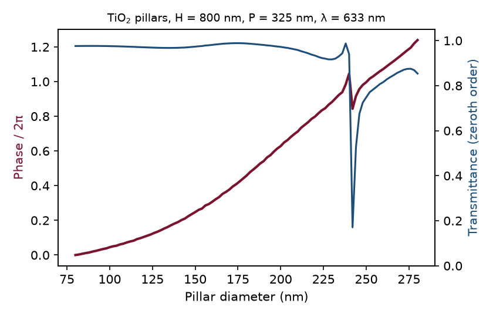
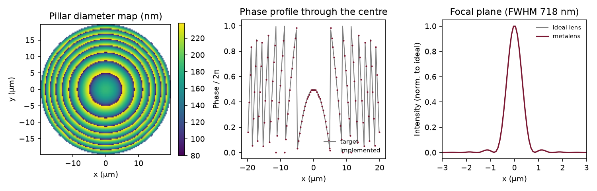
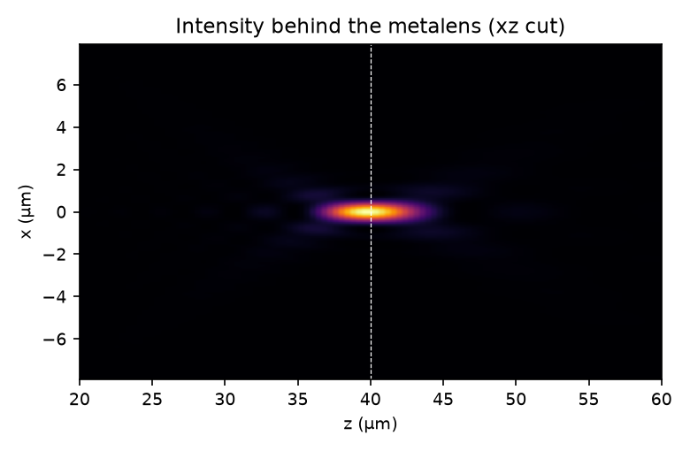
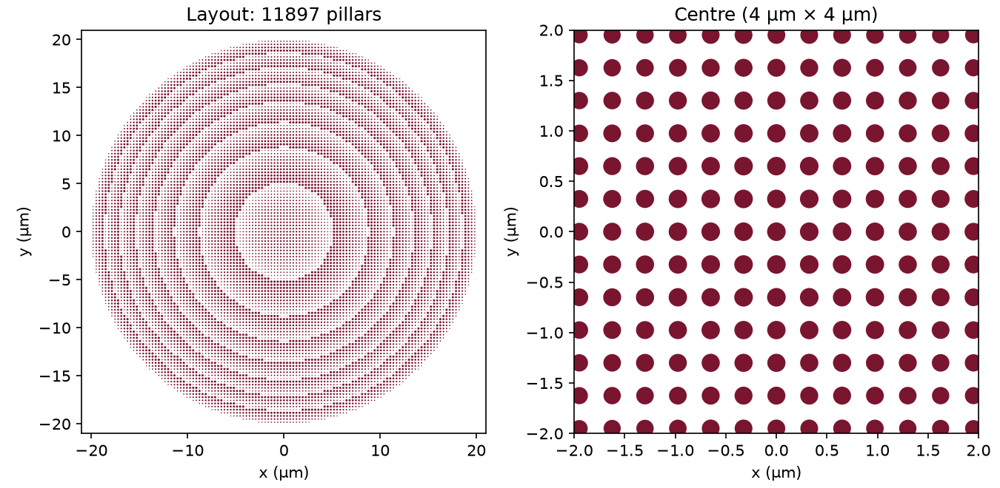

# 02 – TiO₂ metalens: RCWA unit-cell library → lens design → GDS

## Goal

Go through the standard metasurface design flow from start to finish:

1. Simulate one unit cell (a nanopillar) with RCWA and build a library of transmitted phase versus pillar diameter.
2. Use the library to design a lens.
3. Check that the design focuses.
4. Export a GDS file that a fabrication team could use for e-beam lithography.

## Platform

TiO₂ pillars on fused silica at λ = 633 nm, illuminated through the substrate. TiO₂ made by atomic layer deposition is the established route for visible metalenses (Devlin et al., *PNAS* 2016; Khorasaninejad et al., *Science* 2016).

| Parameter | Value |
|---|---|
| Pillar index / height | n = 2.40 / 800 nm |
| Lattice | square, period 325 nm (no diffraction into the glass) |
| Diameter range | 80–280 nm (≥ 45 nm gap between pillars) |
| Lens | D = 40 µm, f = 40 µm, NA = 0.45 |

All parameters are in [`src/design.py`](src/design.py).

## 1. Unit-cell library (RCWA)

[`src/unit_cell_library.py`](src/unit_cell_library.py) uses the open-source RCWA code [grcwa](https://github.com/weiliangjinca/grcwa). For each diameter it computes the complex zeroth-order transmission coefficient for an x-polarised plane wave at normal incidence.

The 800 nm height gives 1.24 × 2π of phase coverage. At 600 nm the coverage was only 0.87 × 2π, so I increased the height. The sharp feature near 240 nm is a pillar resonance with low transmission, and the lens design avoids it.

**Validation** ([`results/rcwa_checks.md`](results/rcwa_checks.md)):

- **Uniform slab, RCWA vs TMM** (TMM code from project 01): R, T, |t| and the phase of t agree to 6 decimal places. This also confirmed how grcwa normalises its amplitudes (t_Fresnel = n_incident × t_grcwa).
- **Fourier-order convergence:** the phase changes by 0.04 rad (2.5°) between 151 and 301 orders. This slow convergence is expected for high-contrast circular pillars on a staircase grid. The library uses 151 orders.

## 2. Lens design

[`src/design_metalens.py`](src/design_metalens.py):

- **Target phase.** The target is the hyperbolic profile φ(r) = −(2π/λ)(√(r² + f²) − f). A constant offset of π is added so that the first phase wrap does not fall at the lens centre.
- **Pillar choice.** At each lattice site, the chosen pillar is the one whose complex t is closest to A·e^{iφ}. Only one 2π period of the library is used, so neighbouring pillars change size smoothly.
- **Focusing check.** The transmitted field (local periodic approximation) is propagated with the angular spectrum method and compared with an ideal lens of the same aperture.

| Quantity | Value |
|---|---|
| Pillars | 11 897 (80–238 nm) |
| Focus position | 39.6 µm (design 40 µm, z step 0.4 µm) |
| Focal spot FWHM | 718 nm (ideal lens 723 nm; Airy limit 728 nm) |
| Strehl ratio vs ideal lens | 0.999 |
| Focusing efficiency (power within 3×FWHM / power through aperture) | 0.82 |

## 3. GDS layout

[`src/make_gds.py`](src/make_gds.py) writes [`results/metalens.gds`](results/metalens.gds) with gdsfactory:

- **Layer (1,0):** pillars. One cell per diameter, placed by reference, which keeps the file at 0.5 MB.
- **Layer (2,0):** lens outline.
- **Layer (3,0):** four alignment crosses and a text label.

I read the file back with KLayout and checked pillar count, positions and diameters against `pillars.csv`.

## Limitations (what this model does not include)

- **Local periodic approximation.** Each pillar is simulated as if it sat in an infinite array of identical pillars. Coupling between neighbouring pillars of different size is ignored, so the real efficiency will be lower than 0.82.
- **Scalar propagation.** The vectorial effects that matter at high NA are not modelled. At NA 0.45 this is a reasonable approximation.
- **Single wavelength and normal incidence.** Chromatic dispersion and off-axis performance are not included.
- **Fixed material index.** TiO₂ is treated as non-dispersive and lossless at 633 nm.

## Next steps

- 2D or 3D full-wave FDTD (Meep) of a lens section to measure the real efficiency beyond the local periodic approximation.
- A fabrication-tolerance study: shift all diameters by ±10 nm and recompute focusing.
- Inverse design of the unit-cell library with Meep's adjoint solver.
