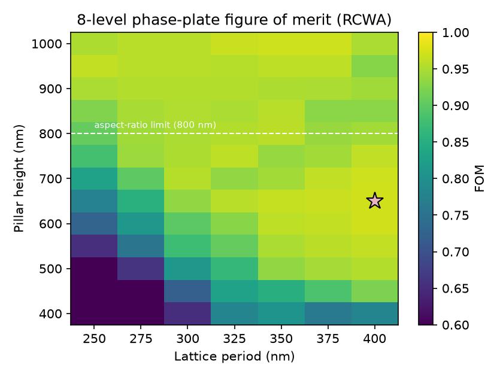
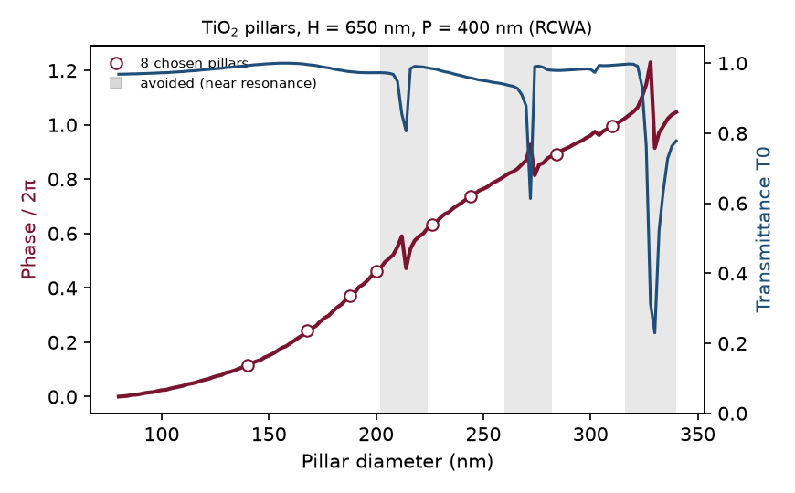
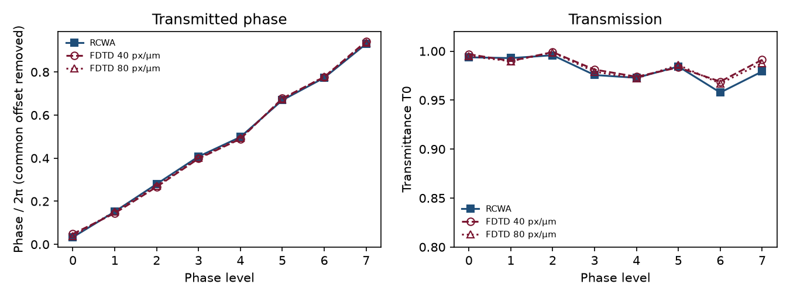
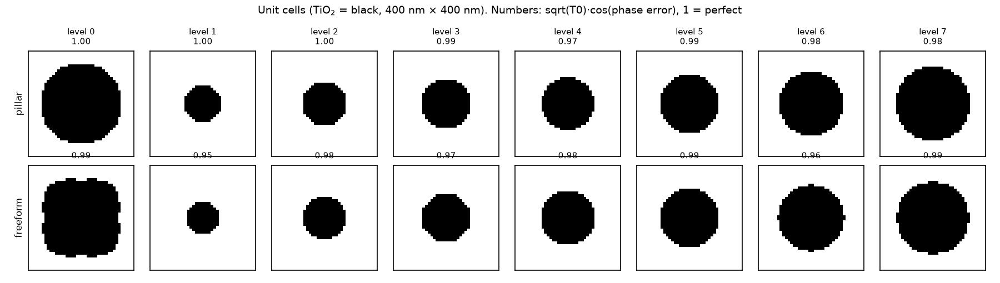
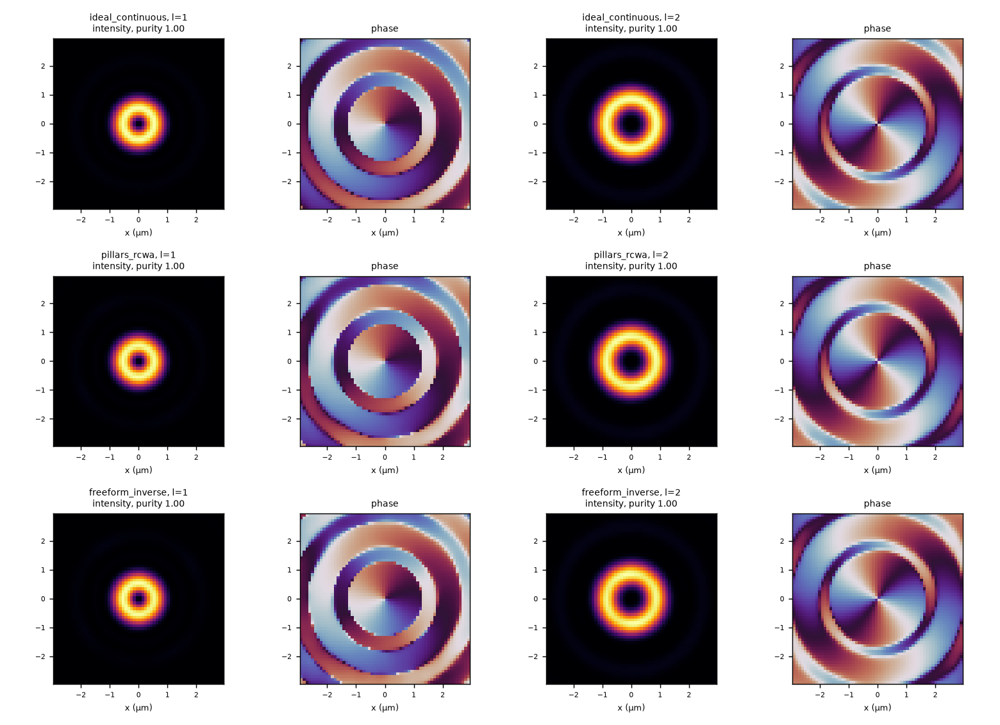
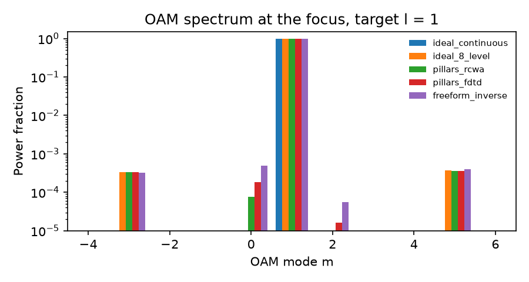
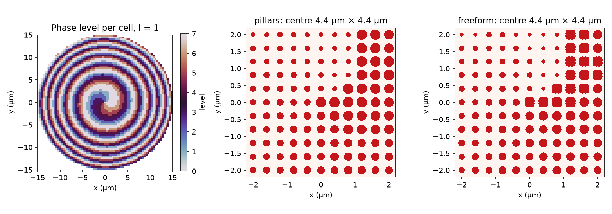

# 03 – Metasurface vortex-beam (OAM) generator: parameter search, RCWA, 3D FDTD, inverse design

## Goal

Design a flat optic that turns a plane wave into a **vortex beam**: a ring of light that carries orbital angular momentum (OAM) of charge *l*. The project covers four methods:

| Step | Method | Script |
|---|---|---|
| 1 | **Parameter search**: choose pillar height and lattice period | [`parameter_search.py`](src/parameter_search.py) |
| 2 | **RCWA**: unit-cell library and choice of 8 phase levels | [`pillar_library.py`](src/pillar_library.py) |
| 3 | **3D FDTD** (Meep): independent check of the 8 unit cells | [`fdtd_unit_cells.py`](src/fdtd_unit_cells.py) |
| 4 | **Inverse design**: freeform unit cells by gradient-based topology optimisation | [`inverse_design.py`](src/inverse_design.py), [`clean_freeform.py`](src/clean_freeform.py) |
| 5 | Vortex plate, beam propagation and OAM analysis | [`vortex.py`](src/vortex.py) |
| 6 | GDS layouts with a manufacturability check | [`make_gds.py`](src/make_gds.py) |

**Device:** the plate imposes φ(x, y) = *l*·atan2(y, x) − k(√(r² + f²) − f), a spiral phase plus a lens. It uses 8 phase levels with TiO₂ on fused silica at λ = 633 nm, and is 30 µm across with a 30 µm focal length. Parameters are in [`src/config.py`](src/config.py).

---

## 1. Parameter search (RCWA)

For each pillar height (400–1000 nm) and period (250–400 nm), the script sweeps the pillar diameter with RCWA. It then scores how well 8 pillars from that sweep can realise 8 phase levels.

The figure of merit is the zeroth-order efficiency of an 8-level phase plate built from those pillars: FOM = |mean_k √T₀ₖ · e^{i(φₖ − targetₖ)}|². It is 1 for perfect, lossless levels, and both phase errors and losses reduce it.

**Fabrication constraints:**
- diameters from 80 nm up to (period − 60 nm);
- height ≤ 10 × 80 nm, an aspect-ratio limit;
- period ≤ 400 nm, so it stays below λ/n_glass = 434 nm and no diffraction occurs in the substrate.

The search runs coarse to fine. The full grid uses 41 Fourier orders, then the 6 best candidates are recomputed with 101 orders and 5 nm diameter steps.



**Result:** H = 650 nm, P = 400 nm, refined FOM = 0.983. Taller pillars give more phase range, but above 800 nm they break the aspect-ratio limit. Larger periods leave more room for big pillars. The best design sits at the largest period allowed, so the substrate diffraction limit is the constraint that is actually active.

## 2. Pillar library and 8 phase levels (RCWA)



- **Resonances avoided.** The library has sharp resonances near 214, 272 and 330 nm. A pillar is only allowed if transmission stays above 0.9 for every diameter within ±10 nm, so a fabrication error of that size cannot land on a resonance (grey bands in the figure).
- **Cost.** This lowers the FOM from 0.984 to 0.972, but makes the design much more tolerant.

## 3. 3D FDTD check (Meep)

Each of the 8 unit cells is simulated in 3D with periodic boundaries, using a broadband plane wave launched in the glass. The field is recorded on a plane in air and averaged over the cell, which gives the zeroth diffraction order. RCWA and FDTD solve Maxwell's equations in completely different ways, so agreement between them is a strong check.



| FDTD resolution | RMS phase difference to RCWA | Max \|ΔT₀\| |
|---|---|---|
| 40 px/µm | 3.7° | 0.012 |
| 80 px/µm | 1.9° | 0.009 |

The difference halves as the FDTD grid is refined. A common phase offset between the two methods is removed first, because only the phase steps between levels affect the device. Building the vortex plate from the FDTD values instead of the RCWA values changes the efficiency by 0.001.

## 4. Inverse design of freeform unit cells

**Setup:**
- **Design region:** each cell is a 40 × 40 pixel pattern (10 nm pixels), with the same height and period as the pillars, so it could be made in the same fabrication step.
- **Symmetry:** C4v symmetry (mirror x, mirror y and diagonal) makes the cell respond the same to x- and y-polarised light.
- **Objective:** maximise √T₀·cos(phase error) for the target phase of the level.
- **Gradients:** automatic differentiation through the RCWA solver (grcwa with the autograd backend). They match a finite difference to 1.4 × 10⁻⁷.
- **Optimiser:** L-BFGS-B with a density filter and a tanh projection that is made steeper in stages until the design is binary.
- **Robust formulation:** a soft minimum over the nominal, eroded and dilated designs, so the optimiser cannot rely on a resonance that only works for one exact shape.
- **Fabrication clean-up:** a morphological opening and closing with a 90 nm disk removes features below the 80 nm limit. The cleaned cells are then re-evaluated with RCWA ([`freeform_cleanup.md`](results/freeform_cleanup.md), [`manufacturability.md`](results/manufacturability.md)).



| | Pillars | Freeform (cleaned) |
|---|---|---|
| 8-level FOM | **0.972** | 0.952 |
| Mean worst-case score with every edge moved ±5 nm | **0.882** | 0.856 |
| Narrowest feature / gap | ≥ 140 nm / ≥ 90 nm | ≥ 90 nm / ≥ 110 nm |

**Finding:** for this simple single-function cell, inverse design did **not** beat a well-chosen pillar library. The optimiser converged to shapes close to pillars. It improved the nominal score of the weakest pillar level (level 4: 0.966 → 0.984), but the overall FOM is lower, for three reasons:
- the optimisation used 101 Fourier orders, but the final check uses 151, and the small phase shifts between the two add up;
- the fabrication clean-up changed two cells;
- the robust objective trades nominal performance for tolerance.

Inverse design pays off when a cell has to do more than one thing, for example different phases for two polarisations or two wavelengths. That is the natural next step for this code.

## 5. The vortex beam

The transmitted field is built cell by cell (local periodic approximation) and propagated to the focal plane with the angular spectrum method.



| Unit cells | *l* = 1: OAM purity | *l* = 1: efficiency | *l* = 2: OAM purity | *l* = 2: efficiency |
|---|---|---|---|---|
| ideal, continuous phase | 1.000 | 0.826 | 1.000 | 0.818 |
| ideal, 8 levels | 0.999 | 0.784 | 1.000 | 0.777 |
| TiO₂ pillars (RCWA) | 0.999 | 0.762 | 1.000 | 0.755 |
| TiO₂ pillars (3D FDTD values) | 0.999 | 0.761 | 0.999 | 0.755 |
| freeform (inverse design) | 0.998 | 0.748 | 0.999 | 0.741 |

*Efficiency: power within r < 3 µm of the focus divided by the power incident on the plate. OAM purity: share of the focal power in mode m = l, from an azimuthal Fourier decomposition of the field on rings.*

- **Check against theory:** the 8-level plate reaches 0.784 / 0.826 = 0.949 of the continuous plate's efficiency. That is exactly the expected loss for 8 phase levels, sinc²(π/8) = 0.949.
- **OAM sidebands:** the small sidebands at m = −3 and m = +5 appear even for ideal cells. They come from the square lattice, whose 4-fold symmetry couples l to l ± 4, not from the unit cells.



**Fabrication tolerance** (*l* = 1, every edge moved by the same amount):

| | −5 nm | nominal | +5 nm |
|---|---|---|---|
| Pillars | 0.747 | 0.762 | 0.758 |
| Freeform | 0.694 | 0.748 | 0.735 |

## 6. GDS layouts

[`vortex_pillars.gds`](results/vortex_pillars.gds) and [`vortex_freeform.gds`](results/vortex_freeform.gds) each contain 4,421 unit cells:
- **Cells:** each of the 8 cell types is stored once and placed by reference.
- **Freeform shapes:** the pixel masks are merged into clean polygons with KLayout before export.
- **Layers:** (1,0) TiO₂, (2,0) outline, (3,0) alignment crosses and label.
- **Check:** the files are read back and the placed cells counted.



## Limitations

- **Local periodic approximation:** each cell is simulated in an array of identical cells. Coupling between different neighbours is not included, so a full-wave simulation of the whole plate would give a somewhat lower efficiency.
- **Scalar propagation** to the focal plane, which is a reasonable approximation at NA ≈ 0.45.
- **Single wavelength, normal incidence, lossless and non-dispersive TiO₂.**

## Run

```bash
cd src
python parameter_search.py     # ~ 2 min
python pillar_library.py       # ~ 1 min
python fdtd_unit_cells.py      # ~ 45 min (40 and 80 px/µm, 3D)
python inverse_design.py       # ~ 30-40 min (8 levels)
python clean_freeform.py       # ~ 10 s
python vortex.py               # ~ 20 s
python make_gds.py             # ~ 10 s
```
Times are for 2 CPU cores. `fdtd_unit_cells.py` reuses saved results; delete `results/fdtd_cells_res*.csv` to rerun them.
