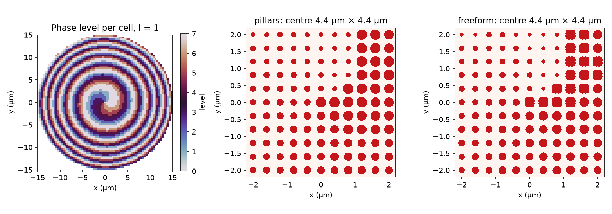
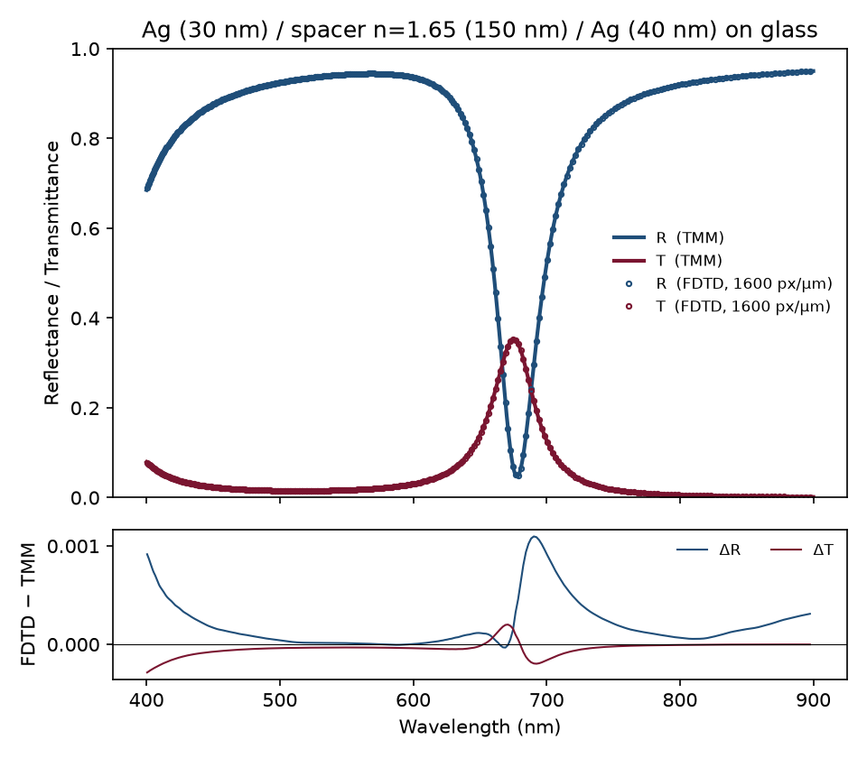
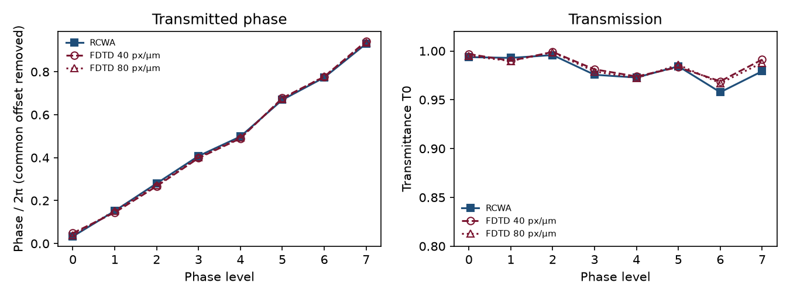

# Nanophotonics simulations: FDTD, RCWA and GDS

Three reproducible projects that take thin-film photonics, the topic of my PhD, towards metasurface design.

| Project | What it shows | Tools |
|---|---|---|
| [01 – Microcavity: FDTD vs TMM](01_cavity_fdtd_vs_tmm) | A 1D FDTD model of an Ag/dielectric/Ag Fabry–Pérot cavity, validated against my own transfer-matrix code, with a grid-convergence study | Meep (FDTD), Python TMM |
| [02 – TiO₂ metalens: RCWA to GDS](02_metalens_rcwa_gds) | An RCWA unit-cell library for TiO₂ nanopillars, a 40 µm metalens designed from it, a focusing check, and a GDS layout ready for e-beam lithography | grcwa (RCWA), gdsfactory, KLayout |
| [03 – Vortex-beam (OAM) generator](03_vortex_beam_generator) | Parameter search for pillar height and period, an RCWA library checked with 3D FDTD, inverse-designed freeform cells, OAM purity and efficiency of the vortex beam, a fabrication-tolerance study and GDS layouts | grcwa + autograd, Meep (3D), gdsfactory, KLayout |

| Method | Where |
|---|---|
| FDTD | 01 (1D, vs TMM), 03 (3D unit cells, vs RCWA) |
| RCWA | 02, 03 (validated against TMM in 02) |
| Parameter search | 03 (height × period, coarse to fine) |
| Inverse design | 03 (adjoint/autodiff topology optimisation, robust formulation) |
| GDS generation | 02, 03 (including freeform shapes merged to polygons) |

Each project checks itself against a method it should agree with exactly:

- **FDTD vs TMM:** the cavity resonance agrees to within 0.01 nm. The RMS difference in reflectance drops from 4×10⁻³ to 3×10⁻⁴ as the grid is refined.
- **RCWA vs TMM:** for a uniform slab, R, T and the complex transmission coefficient agree to 6 decimal places.

<p align="center">
  
</p>
<p align="center">
  
  
</p>

## Quick start

```bash
# Meep is distributed through conda-forge
conda env create -f environment.yml
conda activate nanophotonics-simulations
./run_all.sh            # 01 + 02: ~3 min; 03 adds ~1.5 h (3D FDTD, inverse design)
```

All figures and tables in `*/results/` are produced by these scripts.

## Repository layout

```
01_cavity_fdtd_vs_tmm/
    src/stack.py         cavity definition shared by both methods
    src/tmm.py           transfer-matrix method (s/p, oblique, absorbing media)
    src/run_fdtd.py      Meep 1D FDTD, two-run flux normalisation
    src/compare.py       overlay, Q-factor extraction, convergence, dispersion map
02_metalens_rcwa_gds/
    src/design.py              wavelength, materials, lattice and lens parameters
    src/unit_cell_library.py   RCWA sweep of pillar diameter + validation
    src/design_metalens.py     phase map, pillar choice, focusing check
    src/make_gds.py            GDS export with gdsfactory
03_vortex_beam_generator/
    src/parameter_search.py    height x period search with RCWA
    src/pillar_library.py      library, 8 robust phase levels
    src/fdtd_unit_cells.py     3D Meep check of the 8 cells
    src/inverse_design.py      freeform cells, gradient-based optimisation
    src/clean_freeform.py      minimum-feature clean-up and re-check
    src/vortex.py              vortex plate, propagation, OAM analysis, tolerance
    src/make_gds.py            GDS layouts and manufacturability check
```

## Author

Dr. Parvathi Valsalan, experimental physicist (PhD, Heidelberg University): thin-film microcavities, Fourier-space spectroscopy, ALD and thermal-evaporation fabrication.
